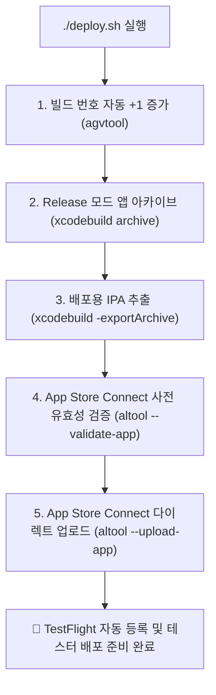

# 🚀 NBA 앱 App Store Connect 원클릭 자동 배포 가이드

이 문서는 외부 서드파티 도구(Fastlane 등)의 무거운 설치 없이, **Apple 공식 CLI 도구(`xcodebuild`, `xcrun altool`)**와 **App Store Connect API Key**를 활용하여 앱을 빌드하고 앱스토어(TestFlight)에 원클릭으로 자동 배포하는 방법을 설명합니다.

---

## 📌 1. 배포 아키텍처 및 동작 원리



---

## 🔑 2. 사전 설정 및 인증 정보

배포 스크립트(`deploy.sh`)는 다음 설정 정보를 바탕으로 동작합니다:

| 항목 | 설정값 / 위치 | 설명 |
| :--- | :--- | :--- |
| **인증 키 파일** | `~/.appstoreconnect/private_keys/AuthKey_N8H3XA3PY5.p8` | Apple CLI 도구 표준 보안 경로 |
| **Key ID** | `N8H3XA3PY5` | App Store Connect API 키 식별자 |
| **Issuer ID** | `69a6de82-3793-47e3-e053-5b8c7c11a4d1` | App Store Connect 팀 발급자 ID |
| **배포 옵션** | `ExportOptions.plist` | App Store 배포용 서명/심볼 업로드 설정 |
| **번들 ID** | `com.spearhead.nbaPowerRanking` | 앱 고유 식별자 |

> 🔒 **보안 안내**: 개인 키(`.p8`)는 개발자의 로컬 Mac 홈 디렉토리(`~/.appstoreconnect/private_keys/`)에 안전하게 보관되며, **Git 저장소에는 절대 커밋되지 않습니다.**

---

## 🛠️ 3. 배포 스크립트 (`deploy.sh`) 사용법

터미널에서 명령어 한 줄로 즉시 실행할 수 있습니다.

### ① 기본 실행 (가장 일반적인 배포)
빌드 번호를 자동으로 1 올리고, 배포용 빌드를 생성한 뒤 TestFlight에 업로드합니다.
```bash
./deploy.sh
```

### ② 업로드 없이 빌드 및 유효성 검증만 수행
실제 앱스토어로 전송하기 전에 Apple 서버의 사전 검증(Validation) 통과 여부만 확인합니다.
```bash
./deploy.sh --validate-only
```

### ③ 빌드 번호 유지 (`--no-bump`)
빌드 번호를 올리지 않고 현재 번호 그대로 빌드 및 배포합니다.
```bash
./deploy.sh --no-bump
```

### ④ 로컬 IPA 생성 테스트 (`--skip-upload`)
인터넷 업로드 없이 로컬에 배포용 `.ipa` 파일만 생성합니다. (`build/nba.ipa`)
```bash
./deploy.sh --skip-upload
```

### ⑤ 도움말 확인
```bash
./deploy.sh --help
```

---

## 🔢 4. 빌드 번호(Build Number) 관리 규칙

* **버전(Marketing Version)**: 예: `1.10` (사용자에게 공개되는 버전 번호)
* **빌드 번호(Current Project Version)**: 예: `1`, `2`, `3`... (App Store Connect에서 각 빌드를 식별하는 정수)

App Store Connect는 동일 버전(`1.10`) 내에서 **이전에 업로드된 빌드 번호와 중복될 경우 업로드를 거절**합니다.  
따라서 `./deploy.sh`는 매 실행 시마다 Apple 공식 버전 도구(`agvtool next-version -all`)를 통해 **빌드 번호를 자동으로 +1 증가**시켜 배포 충돌을 원천 방지합니다.

---

## ⏱️ 5. 업로드 후 처리 과정 (TestFlight)

1. **스크립트 완료**: 터미널에 `🎉 SUCCESS: App successfully uploaded to App Store Connect!`가 출력됩니다.
2. **Apple 서버 처리 (약 5~15분 소요)**:
   - [App Store Connect](https://appstoreconnect.apple.com/apps)의 `TestFlight` 탭으로 이동하면 새 빌드가 **'처리 중(Processing)'** 상태로 표시됩니다.
3. **수출 규정 준수 정보 입력**:
   - 처리가 완료된 후 "수출 규정 준수 정보 누락" 경고가 뜨면 `암호화 사용 안 함(아니오)`을 선택하시면 즉시 활성화됩니다.
4. **테스터 배포**: 내부/외부 테스터에게 TestFlight 알림이 발송되고 테스트가 가능해집니다.

---

## 📝 6. 릴리즈 노트 (Release Notes) 팁

새 버전을 앱스토어 정식 심사에 제출할 때 필요한 릴리즈 노트는 프로젝트 내 **[AppStore_Metadata.md](file:///Users/a1100690/Documents/iOS/nba/AppStore_Metadata.md)**를 참고하세요.

### 이번 2026-27 시즌 개막 추천 릴리즈 노트
```text
🏀 2026-27 NBA 새 시즌 개막 업데이트!

• 2026-27 시즌 개막 지원:
  새 시즌 최신 주차별 파워랭킹, 팀 로스터 및 경기 순위를 실시간으로 확인하세요.

• 시즌 선택 캡슐 토글 추가:
  파워랭킹 상단에서 한 번의 탭으로 2026-27 시즌과 2025-26 지난 시즌 랭킹을 자유롭게 넘나들 수 있습니다.

• 직관적인 2-Tab 네비게이션:
  정규시즌에 집중할 수 있도록 'Power Ranking'과 'Standings' 중심으로 탭 화면을 산뜻하게 개편했습니다.

• 팀 상세 로스터 및 스탯 안정화:
  팀별 최신 로스터와 시즌 기록이 더욱 빠르고 안정적으로 표시됩니다.

• UI 및 사용성 개선:
  개막 주차 데이터 처리를 최적화하고 전반적인 앱 성능을 향상시켰습니다.
```

---

## ❓ 7. 문제 해결 (Troubleshooting)

### Q1. `API Key file not found` 에러가 발생합니다.
* **원인**: 개인 키(`.p8`) 파일이 올바른 경로에 없습니다.
* **해결**: 다운로드받은 키 파일을 다음 경로로 복사합니다:
  ```bash
  mkdir -p ~/.appstoreconnect/private_keys
  cp ~/Downloads/AuthKey_N8H3XA3PY5.p8 ~/.appstoreconnect/private_keys/
  chmod 600 ~/.appstoreconnect/private_keys/AuthKey_N8H3XA3PY5.p8
  ```

### Q2. `Redundant Binary Upload` 에러가 발생합니다.
* **원인**: 동일한 빌드 번호가 이미 App Store Connect에 업로드되어 있습니다.
* **해결**: `./deploy.sh`를 기본 모드로 실행하면 자동으로 빌드 번호가 증가하여 해결됩니다. 또는 수동으로 증가:
  ```bash
  agvtool next-version -all
  ```

### Q3. `No Accounts with App Store Connect Access` 또는 프로비저닝 에러
* **해결**: Xcode > Settings > Accounts에서 본인 Apple Developer 계정이 로그인되어 있고 인증서가 유효한지 확인합니다.
